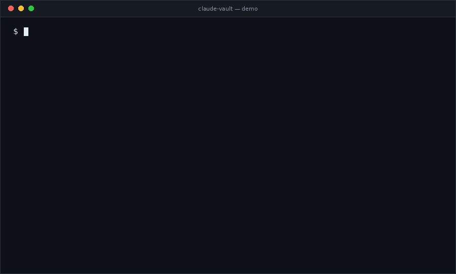

<div align="center">

# 🔐 claude-vault

**Your AI coding agent knows the *name* of your password. Never the value.**

[](https://github.com/jbasoft/claude-vault/actions/workflows/ci.yml)
[](https://pypi.org/project/claude-vault/)
[](https://pypi.org/project/claude-vault/)
[](LICENSE)

A credential manager built for the one thing agents are bad at: needing a secret
without seeing it.

**English** · [فارسی](docs/README.fa.md) · [العربية](docs/README.ar.md) · [Français](docs/README.fr.md) · [Türkçe](docs/README.tr.md) · [Español](docs/README.es.md)

</div>

<div align="center">



</div>

---

## The problem

You are working with Claude Code. It needs to run a migration, call an API, or
log into a server. So it says:

> *"I'll need the database password — please add it to your `.env` and I'll continue."*

Every path from here is bad:

| What you do | What goes wrong |
|---|---|
| Paste it in chat | The value is now in the transcript, in `~/.claude/projects/`, and in the request sent to the model provider. Forever. |
| Put it in `.env` | The agent reads the file. Same outcome, plus a file that gets committed by accident. |
| Run the command yourself | You are now the agent's hands. The flow you wanted is gone. |
| Hardcode it "temporarily" | You know how this ends. |

The agent is right to refuse the secret. But "handle it yourself" is not a
workflow, and nobody keeps 30 production passwords in their head.

## The fix

Split the credential in two: the agent gets the **name**, you type the **value**.

```bash
# The agent runs this. A dialog opens on YOUR machine.
vault need DB_PASSWORD

# The agent runs this. $DB_PASSWORD exists inside the child process only.
vault run DB_PASSWORD -- dotnet ef database update
```

The value never passes through the agent's context, its transcript, or the API
request. The agent never had it, so it cannot leak it.

```
                    ┌──────────────────────────────────┐
   vault need  ───▶ │  native dialog on your machine   │ ──┐
                    └──────────────────────────────────┘   │
                                                            ▼
   agent context ✗ ─────────────────────────────▶   OS keychain / AES-GCM file
   transcript    ✗                                          │
   model request ✗                                          │ injected as env var
                    ┌──────────────────────────────────┐   │
   vault run   ───▶ │  child process (psql, dotnet…)   │ ◀─┘
                    └──────────────┬───────────────────┘
                                   │ stdout / stderr
                    ┌──────────────▼───────────────────┐
                    │  scrubber: value → ***REDACTED*** │ ──▶ back to the agent
                    └──────────────────────────────────┘
```

## Quickstart

```bash
pip install claude-vault        # or: pipx install claude-vault
vault install-claude            # installs the skill, guard hook and deny rules
```

Restart Claude Code. That is the whole setup. Next time it needs a credential it
will use the vault on its own — the skill description triggers on 401s, "missing
API key", and anything that smells like authentication.

Try it yourself:

```bash
vault need GITHUB_TOKEN                      # dialog opens, you type, done
vault run GITHUB_TOKEN -- gh auth status     # token present, value redacted
vault list                                   # names only, always safe
```

---

## Four features that matter

### 1. `vault run` — inject, then scrub

Secrets become environment variables for one child process. Everything the child
writes is filtered on the way back, including the forms a leak actually takes:
raw, URL-encoded, base64, JSON-escaped, and split across read buffers.

```bash
vault run STRIPE_SECRET_KEY -- curl -v https://api.stripe.com/v1/charges
# → Authorization: Bearer ***REDACTED:STRIPE_SECRET_KEY***
```

That redaction is the point: the agent can run verbose commands and read real
error output without the secret riding along. Remap when the variable name
differs:

```bash
vault run DB_PASSWORD:ConnectionStrings__Default -- dotnet run
```

### 2. `vault need` — the agent asks, you answer, out of band

One command the agent is allowed to call that results in a credential existing.
It prints names, opens a dialog for whatever is missing, blocks until you
finish, and exits non-zero if you cancel. The dialog is drawn by the vault
process, so the keystrokes have nowhere else to go.

```bash
vault need DB_PASSWORD SMTP_PASSWORD API_TOKEN --with-username
```

Headless CI gets `vault set NAME --stdin`; a terminal with no display falls back
to a `getpass` prompt with confirmation.

### 3. `vault template` — config files that stay in git

The real reason secrets end up committed is that `appsettings.json` needs one.
Commit a template instead:

```jsonc
// appsettings.Development.template.json  ← safe to commit
{ "ConnectionStrings": { "Default": "Server=db;Password=${VAULT:DB_PASSWORD}" } }
```

```bash
vault template appsettings.Development.template.json appsettings.Development.json
```

Rendered with `0600` permissions, and it warns you if the output is not
gitignored. Works for any text format — `.json`, `.yaml`, `.toml`, `.conf`,
`.tfvars`. When a tool can only read dotenv, `vault env NAME --to .env.local`
writes the file without ever printing it.

### 4. The guard hook — enforcement, not etiquette

A `SKILL.md` tells the model what to do. A `PreToolUse` hook makes it true.
`vault install-claude` registers a guard that blocks the handful of commands
that would move a value into the conversation:

- `vault get`, `vault env --unsafe-stdout`, `vault run --no-scrub`
- `cat`/`Read` on a `.env` file, `master.key`, or `secrets.enc`
- `echo $DB_PASSWORD`, `printenv`, environment dumps

Blocked calls return an explanation to the model, so it corrects itself and
carries on instead of stalling:

```
[claude-vault] Blocked.
`vault get` prints a secret value into the transcript. Use
`vault run <NAME> -- <your command>` instead, which injects it as an
environment variable and scrubs it from the output.
```

The hook merges into your existing `settings.json` — your own hooks are kept —
and fails open on anything unexpected, because a guard that breaks workflows
gets uninstalled, and an uninstalled guard protects nothing.

---

## Also in the box

**Profiles** — one vault, many environments.

```bash
vault --profile prod run DB_PASSWORD -- ./migrate.sh
vault --profile staging list
```

**Six languages**, dialog and CLI, with right-to-left layout for Persian and
Arabic. Detected from your locale, or set it: `vault lang fa`.

| | | | | | |
|---|---|---|---|---|---|
| English | فارسی | العربية | Français | Türkçe | Español |

**`vault doctor`** — backend, vault path, keyring implementation, whether the
GUI is reachable, whether the guard is installed, file permission problems.

**Configurable location** — `VAULT_HOME` puts the vault anywhere: an encrypted
volume, a synced folder, a per-project directory.

---

## Security model

**Storage.** The OS credential store when one is available (Windows Credential
Manager, macOS Keychain, Secret Service). Otherwise an AES-256-GCM encrypted
file whose data key is wrapped with DPAPI on Windows, kept in the keyring where
there is one, or written to a `0600` key file as a last resort — with a warning,
because that last case is weaker and you should know.

The index — names, kinds, notes, timestamps — is plain JSON on purpose. Names
are not secret, and the agent needs to read them.

**What this protects against:** credentials entering an LLM context window, a
chat transcript, a provider's logs, your shell history, a `git commit`, or a
screen-share.

**What it does not protect against** — stated plainly, because a security tool
that oversells itself is worse than none:

- Malware or another process running as you. Anything you can decrypt, it can.
- A program you deliberately run that exfiltrates its own environment.
- A secret the model saw *before* you installed this. Rotate those.
- A determined agent with unrestricted shell access. The hook raises the cost of
  a leak; it is not a sandbox.

This is defence in depth for the *accidental* leak, which is the one that
actually happens.

---

## Compared to

| | claude-vault | `.env` files | 1Password / Bitwarden CLI | `dotnet user-secrets` |
|---|---|---|---|---|
| Agent can read the value | ✗ blocked | ✓ trivially | ✓ `op read` prints it | ✓ plaintext on disk |
| Output scrubbing | ✓ | — | ✗ | ✗ |
| Prompts the human on demand | ✓ | ✗ | partially | ✗ |
| Agent guard rails | ✓ hook + rules | ✗ | ✗ | ✗ |
| Needs an account | ✗ | ✗ | ✓ | ✗ |
| Team sharing | ✗ | ✗ | ✓ | ✗ |

Already paying for 1Password or Bitwarden? Keep them — `op run` and `bws run`
do the injection well and sync across a team. claude-vault is for everyone else,
and it adds the two pieces those tools lack: output scrubbing and an agent that
is actively prevented from reading values.

## FAQ

<details>
<summary><b>Does this work with Cursor, Aider, Copilot, Codex?</b></summary>

The CLI works anywhere — it is just a command. `vault run` and the scrubber are
agent-agnostic, and `vault get` is refused inside Cursor and Aider too. The
skill and the `PreToolUse` hook are Claude Code specific; equivalents for other
agents are welcome as PRs.
</details>

<details>
<summary><b>What if I paste a secret into the chat by accident?</b></summary>

It is in the transcript and in the provider's request log. Rotate it. Then store
the replacement with `vault need`. The skill instructs the model to tell you
this plainly rather than quietly accepting the paste.
</details>

<details>
<summary><b>Why not just use an MCP server?</b></summary>

An MCP tool returns its result into the context window — which is exactly the
thing to avoid. The value has to move through a channel the model cannot read,
and a child process's environment is that channel.
</details>

<details>
<summary><b>Can I use it for SSH?</b></summary>

Use a key and `ssh-agent`. The skill says so too. If you must store a
passphrase, `vault run SSH_PASSPHRASE -- sshpass -e ssh …` works, but a key is
better in every way.
</details>

<details>
<summary><b>Is the vault synced between machines?</b></summary>

No, by design. Point `VAULT_HOME` at a synced folder if you want that — the file
backend is encrypted at rest, so the sync provider sees ciphertext. Note that
the keyring backend does not move with the file.
</details>

## Contributing

Issues and PRs welcome, particularly: guard rules for other agents, locales, and
real-world leak patterns the scrubber misses. A failing test for the leak is the
most useful thing you can send.

```bash
git clone https://github.com/jbasoft/claude-vault && cd claude-vault
pip install -e ".[dev]"
pytest -q
```

See [CONTRIBUTING.md](CONTRIBUTING.md) and [SECURITY.md](SECURITY.md).

## License

MIT — see [LICENSE](LICENSE).

---

<div align="center">

If this saved you from pasting a production password into a chat window,
**a ⭐ costs nothing and helps other people find it.**

</div>
